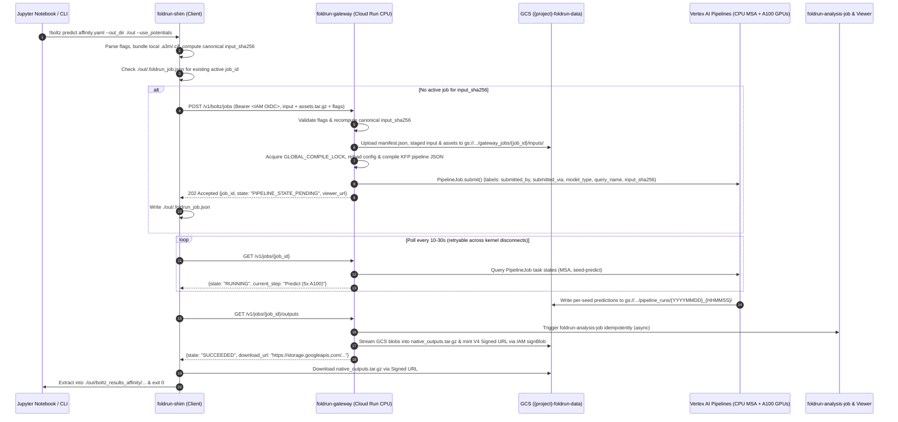

# FoldRun Direct Cloud Run Gateway & Native CLI / Notebook Shim

- **Repository:** `https://github.com/GoogleCloudPlatform/LifeSciences` (`applications/foldrun`)
- **Status:** Approved
- **Date:** 2026-10-23

---

## Overview

FoldRun provisions a cloud platform for biomolecular structure and binding-affinity prediction using **AlphaFold 2** (`af2`), **OpenFold 3** (`of3`), and **Boltz-2** (`boltz2`). It combines a 2.5 TB SSD-backed Cloud Filestore NFS share (`/mnt/nfs/foldrun`) containing 15 genetic and structural reference databases with auto-scaling Vertex AI Pipelines that run CPU-bound Multiple Sequence Alignment (MSA) on high-CPU VMs (`c2-standard-16`) and structure prediction across parallel NVIDIA A100 GPUs (`a2-highgpu-1g` 40 GB and `a2-ultragpu-1g` 80 GB).

Today, FoldRun can only be invoked through a conversational AI agent running on Vertex AI Agent Engine ([`foldrun-agent/foldrun_app/agent.py`](../../foldrun-agent/foldrun_app/agent.py)). This design introduces a direct, non-agentic execution path consisting of:
1. A stateless **Cloud Run HTTP Gateway** (`foldrun-gateway`) protected by Google Cloud IAM (`roles/run.invoker`), backed by the existing shared Vertex AI Pipeline engine.
2. A `pip`-installable **Client & Jupyter Notebook Shim** (`foldrun-shim`) that exposes the native command-line interfaces (`boltz`, `run_openfold`, `run_alphafold.py`) and a Python notebook helper so public GitHub examples and Jupyter Notebook tutorials run against FoldRun in Google Cloud without code changes and without local GPUs.

---

## The Problem

Scientists and machine learning engineers evaluate and adopt structure prediction models by running public tutorials, command-line examples, and Jupyter Notebooks published in the upstream Boltz-2, OpenFold 3, and AlphaFold 2 repositories. Today, running those examples against FoldRun's cloud infrastructure fails for four reasons:

1. **No Direct Programmatic or Native CLI Entrypoint**:
   - All job submissions must pass through a natural-language conversational agent ([`foldrun-agent/foldrun_app/agent.py`](../../foldrun-agent/foldrun_app/agent.py)). Automated bioinformatics workflows, scripts, and Jupyter Notebook shell cells (`!boltz predict ...`, `!run_openfold predict ...`, `!python run_alphafold.py ...`) cannot invoke FoldRun directly.
2. **Loss of Native Input Schemas, Embedded Local Assets, and CLI Flags**:
   - The existing agent submission tools ([`BOLTZ2SubmitPredictionTool`](../../foldrun-agent/foldrun_app/models/boltz2/tools/submit_prediction.py), [`OF3SubmitPredictionTool`](../../foldrun-agent/foldrun_app/models/of3/tools/submit_prediction.py)) pass inputs through format converters and invoke Kubeflow Pipeline (KFP) predict components ([`boltz2/pipeline/components/predict.py`](../../foldrun-agent/foldrun_app/models/boltz2/pipeline/components/predict.py), [`of3/pipeline/components/predict.py`](../../foldrun-agent/foldrun_app/models/of3/pipeline/components/predict.py)) that hardcode the container command line.
   - The agent submission tools drop scientific flags used in public examples (such as `--use_potentials`, `--recycling_steps`, `--sampling_steps`, `--step_scale`, `--write_full_pae`, and `--max_template_date`).
   - Public Boltz-2 YAML (`affinity.yaml`) and OpenFold 3 JSON (`query.json`) examples reference local files on disk (such as pre-computed `.a3m` or `.sto` alignments, `.cif` templates, or custom `runner.yaml` files). Because the submission tools do not bundle or stage those local files to Cloud Storage, and because [`msa_pipeline_boltz2`](../../foldrun-agent/foldrun_app/models/boltz2/pipeline/components/msa_pipeline.py) and [`msa_pipeline_of3`](../../foldrun-agent/foldrun_app/models/of3/pipeline/components/msa_pipeline.py) unconditionally overwrite `msa` and `main_msa_file_paths` with NFS cache paths, remote Vertex AI workers cannot consume user-supplied alignments or templates.
3. **Cross-Model Pipeline Compilation Race Conditions**:
   - While [`AF2Tool`](../../foldrun-agent/foldrun_app/models/af2/base.py) defines a class-level `_compile_env_lock` and [`OF3SubmitPredictionTool`](../../foldrun-agent/foldrun_app/models/of3/tools/submit_prediction.py) defines a module-local `_COMPILE_LOCK`, [`BOLTZ2SubmitPredictionTool`](../../foldrun-agent/foldrun_app/models/boltz2/tools/submit_prediction.py) has no lock, and all three models mutate process-global `os.environ`, `sys.path`, and `foldrun_app.models.<model>.pipeline.config` without sharing a single process-wide lock or reloading cached `config` modules.
4. **Mismatch Between Blocking Notebook/CLI Commands and Long-Running Cloud Pipelines**:
   - Upstream CLI commands and Jupyter Notebook cells block until output files (`.cif`, `.pdb`, `confidence_*.json`, `affinity_*.json`) are written to the local `--out_dir` / `--output_dir`.
   - However, a full MSA + multi-seed A100 pipeline on Vertex AI takes 15 to 90+ minutes—exceeding Cloud Run's 60-minute HTTP timeout and risking lost work if a notebook kernel or laptop Wi-Fi disconnects mid-job.

---

## Goals

- **G1 — Unmodified Native CLI & Jupyter Notebook Execution**: Allow users to run public GitHub CLI examples and Jupyter Notebook cells (`!boltz predict ...`, `!run_openfold predict ...`, `!python run_alphafold.py ...`) without editing the command or downstream visualization cells (`py3Dmol`, `biotite`, `matplotlib`), materializing the upstream output directory structure into the local `--out_dir` / `--output_dir`.
- **G2 — 100% Cloud Execution on Auto-Scaling Vertex AI A100s (Zero Local GPUs)**: Execute all database lookups, MSA alignments, and GPU predictions in Google Cloud using FoldRun's existing Cloud Filestore NFS (`/mnt/nfs/foldrun`) and Vertex AI A100 Pipelines (`dsl.ParallelFor` multi-GPU seed fan-out + Dynamic Workload Scheduler `FLEX_START`), requiring zero local GPU hardware or local databases.
- **G3 — Minimal Cloud Infrastructure Footprint**: Add only a single stateless CPU Cloud Run Service (`foldrun-gateway`, scaling to zero when idle) built from the existing [`foldrun-agent`](../../foldrun-agent) package, avoiding a second GPU compute tier or duplicated pipeline definitions.
- **G4 — Thin-Permission Client Security (`roles/run.invoker` Only)**: Authenticate client and notebook requests via Google Cloud IAM OIDC identity tokens (`roles/run.invoker` on `foldrun-gateway`) without requiring end users to hold direct IAM read/write roles on the internal GCS buckets or Vertex AI Pipelines.
- **G5 — Safe Native Flag & Local Asset Pass-Through**: Bundle local files referenced inside native YAML/JSON inputs (`.a3m`, `.sto`, `.cif`, `runner.yaml`) to GCS and route allowlisted scientific CLI flags to KFP pipeline parameters or model containers while blocking flags that could override container mounts (`--cache`, `--out_dir`, `--data_dir`, `--inference_ckpt_path`).
- **G6 — Interrupt-Resilient Execution & Full Viewer Compatibility**: Persist a local job token (`.foldrun_job.json`) in `--out_dir` so interrupted CLI or Jupyter Notebook cells automatically re-attach to the running Vertex AI pipeline upon re-execution, and trigger `foldrun-analysis-job` with compatible labels and job IDs so direct jobs appear in [`foldrun-viewer`](../../src/foldrun-viewer/app.py).

---

## Non-Goals

- **NG1 — Serving GPU Inference on Cloud Run GPUs**: Cloud Run does not offer NVIDIA A100 GPUs and enforces a 60-minute execution limit on GPU tasks. All GPU inference remains on Vertex AI Pipelines.
- **NG2 — Local GPU Execution**: Supporting hybrid local-GPU inference with remote MSA servers is out of scope; 100% of compute executes in Google Cloud.
- **NG3 — Deprecating the Conversational ADK Agent**: The existing Vertex AI Agent Engine agent and its tool interfaces remain supported and backward-compatible.
- **NG4 — Arbitrary Shell or Unvalidated Flag Execution**: The gateway will not execute arbitrary shell commands or unvalidated container flags outside the per-model scientific flag allowlist.

---

## Open Questions

- *None.*

---

## Critical User Journeys (CUJs)

### CUJ 1: Unmodified Public GitHub Jupyter Notebook Execution

- **Given**: A scientist opens a public Boltz-2 or OpenFold 3 tutorial notebook in Colab Enterprise, Vertex AI Workbench, or a CPU-only laptop, installs `foldrun-shim` (`%pip install ...`), and sets `FOLDRUN_GATEWAY_URL` with `roles/run.invoker` credentials.
- **When**: The scientist executes an unmodified notebook cell such as `!boltz predict examples/affinity.yaml --out_dir ./out --diffusion_samples 5 --use_potentials` followed by a standard Python cell that loads `./out/boltz_results_affinity/predictions/affinity/affinity_model_0.cif` into `py3Dmol`.
- **Then**: `foldrun-shim` authenticates to `foldrun-gateway` via IAM OIDC, uploads `examples/affinity.yaml`, submits the Vertex AI A100 pipeline with `--use_potentials` and 5 diffusion samples, streams step progress to the notebook output cell, downloads and unpacks the resulting `.cif` and `.json` files into `./out/boltz_results_affinity/...`, and the subsequent `py3Dmol` cell renders the 3D structure without modification.

### CUJ 2: Automatic Recovery from Notebook Kernel Disconnect

- **Given**: A user starts a 45-minute structure prediction from a Jupyter Notebook cell (`!run_openfold predict --query_json query.json --output_dir ./out`), and `foldrun-shim` records the submitted `job_id` and canonical `input_sha256` digest in `./out/.foldrun_job.json`.
- **When**: The user's browser tab or notebook kernel disconnects after 15 minutes while the Vertex AI A100 pipeline is still running, and the user re-runs the same notebook cell.
- **Then**: `foldrun-shim` reads `./out/.foldrun_job.json`, verifies the canonical `input_sha256` digest matches and the remote job is still active (or succeeded) on `foldrun-gateway`, re-attaches to the existing `job_id` without submitting a duplicate A100 pipeline run, and downloads the final outputs into `./out` upon completion.

### CUJ 3: Native Input Referencing Local Custom MSAs or Templates

- **Given**: A user runs `boltz predict custom_complex.yaml --out_dir ./out` where `custom_complex.yaml` contains a relative local file reference (`msa: ./alignments/chain_A.a3m`) or template (`cif: ./templates/homolog.cif`).
- **When**: `foldrun-shim` parses `custom_complex.yaml` prior to submission.
- **Then**: `foldrun-shim` packages `custom_complex.yaml`, `./alignments/chain_A.a3m`, and `./templates/homolog.cif` into an upload bundle; `foldrun-gateway` stages the assets to `gs://{project}-foldrun-data/gateway_jobs/{job_id}/inputs/assets/` and rewrites the relative paths in the staged YAML to `/gcs/{project}-foldrun-data/gateway_jobs/{job_id}/inputs/assets/...` so [`msa_pipeline_boltz2`](../../foldrun-agent/foldrun_app/models/boltz2/pipeline/components/msa_pipeline.py) preserves the pre-staged alignment and skips `jackhmmer`.

---

## Technical Plan (Architecture)

### 1. System Architecture & Data Flow

The architecture splits into three layers that share FoldRun's existing storage and compute planes:
1. **Client & Notebook Layer (`sdk/foldrun-shim/`)**: Parses native model CLI invocations (`boltz`, `run_openfold`, `run_alphafold.py`), bundles referenced local files, mints IAM OIDC tokens, tracks local job state (`.foldrun_job.json`), and unpacks outputs into `--out_dir`.
2. **Gateway Control Plane (`foldrun-agent/foldrun_app/gateway/`)**: A stateless FastAPI service deployed on Cloud Run CPU (`foldrun-gateway`). Validates flags against per-model allowlists, stages input bundles to GCS, compiles KFP pipelines under `GLOBAL_COMPILE_LOCK`, delegates submission and status checks to the shared model tools, triggers post-run analysis (`foldrun-analysis-job`), and streams per-seed GCS artifacts into a native output archive.
3. **Shared Pipeline & Storage Plane (`foldrun-agent/foldrun_app/models/`, Vertex AI, Filestore NFS, GCS)**: Executes CPU MSA on `c2-standard-16` and parallel GPU structure prediction on `a2-highgpu-1g` (A100 40 GB) or `a2-ultragpu-1g` (A100 80 GB) via `dsl.ParallelFor` and Dynamic Workload Scheduler (`FLEX_START`).



---

### 2. Component 1: Shared Pipeline Engine Enhancements (`foldrun-agent/foldrun_app/`)

To avoid maintaining two copies of the KFP pipelines, we extend the existing pipeline modules in [`foldrun-agent/foldrun_app/models/`](../../foldrun-agent/foldrun_app/models) with three backward-compatible additions:

#### 2.1 Process-Wide Compilation Lock & Config Reloading (`foldrun_app/core/compile_lock.py`)
- Currently, [`AF2Tool`](../../foldrun-agent/foldrun_app/models/af2/base.py) defines a class-level `_compile_env_lock = threading.RLock()`, [`AF2SubmitMonomerTool`](../../foldrun-agent/foldrun_app/models/af2/tools/submit_monomer.py) defines `_COMPILE_ENV_LOCK = threading.Lock()`, [`af2/utils/pipeline_utils.py`](../../foldrun-agent/foldrun_app/models/af2/utils/pipeline_utils.py) defines `_PIPELINE_LOAD_LOCK = threading.Lock()`, [`OF3SubmitPredictionTool`](../../foldrun-agent/foldrun_app/models/of3/tools/submit_prediction.py) defines `_COMPILE_LOCK = threading.Lock()`, and [`BOLTZ2SubmitPredictionTool`](../../foldrun-agent/foldrun_app/models/boltz2/tools/submit_prediction.py) has no lock.
- In addition, `load_vertex_pipeline()` in [`boltz2/utils/pipeline_utils.py`](../../foldrun-agent/foldrun_app/models/boltz2/utils/pipeline_utils.py) and [`of3/utils/pipeline_utils.py`](../../foldrun-agent/foldrun_app/models/of3/utils/pipeline_utils.py) only inserts `vertex_pipeline_dir` into `sys.path` if not already present (leaving an earlier model's directory at `sys.path[0]`), and none of the three `load_vertex_pipeline()` helpers reload `foldrun_app.models.<model>.pipeline.config` in `sys.modules` before reloading the pipeline module.
- We introduce `GLOBAL_COMPILE_LOCK = threading.RLock()` in `foldrun_app/core/compile_lock.py`, alias all existing per-model lock attributes (`AF2Tool._compile_env_lock`, `submit_monomer._COMPILE_ENV_LOCK`, `af2/utils/pipeline_utils._PIPELINE_LOAD_LOCK`, and `of3/tools/submit_prediction._COMPILE_LOCK` / `_COMPILE_ENV_LOCK`) to `GLOBAL_COMPILE_LOCK`, wrap `BOLTZ2SubmitPredictionTool` and `AF2SubmitMultimerTool` compilation with `GLOBAL_COMPILE_LOCK`, and update `{af2,of3,boltz2}/utils/pipeline_utils.py` to always move `vertex_pipeline_dir` to `sys.path[0]` and call `importlib.reload()` on `foldrun_app.models.<model>.pipeline.config`.

#### 2.2 Per-Model Scientific Flag Allowlist (`foldrun_app/gateway/flag_allowlist.py`)
- Because KFP worker containers mount `/mnt/nfs/foldrun` read-write and multi-seed execution is orchestrated via KFP `dsl.ParallelFor`, `flag_allowlist.py` validates client-supplied CLI flags with `argparse(allow_abbrev=False)`, enforces numeric bounds, and partitions flags into **(a) KFP Pipeline Parameters** vs. **(b) Container `extra_cli_args`**:

| Model | Native Flags Mapped to KFP Pipeline Parameters | Allowlisted Native Flags Appended to Container (`extra_cli_args`) | Blocked / Stripped Infrastructure Flags |
| :--- | :--- | :--- | :--- |
| **Boltz-2 (`boltz predict`)** | `--diffusion_samples` (`1..25` $\rightarrow$ `num_diffusion_samples`), `--seed` (`int` $\rightarrow$ `base_seed`), `--num_model_seeds` (`1..10` $\rightarrow$ `num_model_seeds`, default `1` for CLI parity) | `--recycling_steps` (`1..20`), `--sampling_steps` (`1..1000`), `--step_scale` (`0.1..10.0`), `--use_potentials` (`bool`), `--write_full_pae` (`bool`), `--write_full_pde` (`bool`), `--max_msa_seqs` (`32..16384`), `--subsample_msa` (`bool`), `--num_subsampled_msa` (`1..4096`), `--sampling_steps_affinity` (`1..1000`), `--diffusion_samples_affinity` (`1..25`), `--affinity_mw_correction` (`bool`) | `--out_dir`, `--cache`, `--devices`, `--accelerator`, `--num_workers`, `--use_msa_server`, `--msa_server_url`, `--output_format` (kept as `mmcif` on worker; `--override` handled by client shim) |
| **OpenFold 3 (`run_openfold predict`)** | `--num_diffusion_samples` (`1..25` $\rightarrow$ `num_diffusion_samples`), `--num_model_seeds` (`1..10` $\rightarrow$ `num_model_seeds`, default `1` for CLI parity), `--use_templates` (`bool` $\rightarrow$ `use_templates`) | Safe `runner.yaml` scientific overrides (`model_update.presets`, `low_mem`, `plddt`, `pae`) passed via `custom_runner_yaml_overrides` | `--query_json`, `--output_dir`, `--inference_ckpt_path`, `--runner_yaml` (host path), `--use_msa_server` |
| **AlphaFold 2 (`run_alphafold.py`)** | `--model_preset` (`monomer`\|`monomer_casp14`\|`monomer_ptm`\|`multimer`), `--db_preset` (`full_dbs` $\rightarrow$ `use_small_bfd=False`, `reduced_dbs` $\rightarrow$ `use_small_bfd=True`), `--max_template_date` (`YYYY-MM-DD`), `--models_to_relax` (`all`\|`best` $\rightarrow$ `run_relax=True`; `none` $\rightarrow$ `run_relax=False`), `--num_multimer_predictions_per_model` (`1..25`), `--msa_method` (`auto`\|`jackhmmer`\|`mmseqs2`) | *(None — AF2 KFP components invoke Python APIs directly)* | `--fasta_paths`, `--output_dir`, `--data_dir`, `--*_database_path`, `--*_binary_path`, `--use_gpu_relax`, `--use_precomputed_msas` |

#### 2.3 Backward-Compatible KFP Component Extensions & Cloud Storage FUSE Asset Staging
- **Boltz-2 Predict Component ([`boltz2/pipeline/components/predict.py`](../../foldrun-agent/foldrun_app/models/boltz2/pipeline/components/predict.py))**:
  - Add `extra_cli_args: list[str] = []` to `predict_boltz2` and `boltz2_inference_pipeline`.
  - Append validated `extra_cli_args` to the `cmd = ["boltz", "predict", ...]` list passed to `subprocess.run(cmd, check=True)`.
  - Because `output_dir = os.path.dirname(predicted_structure.path)` is already a GCSFuse mount (`/gcs/<bucket>/pipeline_runs/...`), all generated `.cif`, `confidence_*.json`, `affinity_*.json`, `pae_*.npz`, and `pde_*.npz` files inside `boltz_results_patched_query/` are automatically persisted to GCS without creating a duplicate per-seed archive.
- **OpenFold 3 Predict Component ([`of3/pipeline/components/predict.py`](../../foldrun-agent/foldrun_app/models/of3/pipeline/components/predict.py))**:
  - Add `extra_cli_args: list[str] = []` and `custom_runner_yaml_overrides: dict = {}` to `predict_of3` and `of3_inference_pipeline`.
  - Update `predict_of3` to write `runner_yaml_path = os.path.join(output_dir, "runner.yaml")` whenever `(use_templates and nfs_mmcif_dir) or custom_runner_yaml_overrides`, deep-merging `custom_runner_yaml_overrides` into `runner_config` while enforcing `template_preprocessor_settings.structure_directory = nfs_mmcif_dir` when templates are enabled.
- **Custom Asset Staging via Vertex AI `/gcs/` Mount & MSA Pipeline Bypass**:
  - Vertex AI custom training containers automatically mount Cloud Storage buckets at `/gcs/<bucket_name>/`.
  - When a user's Boltz-2 YAML (`sequences[*].protein.msa: ./custom.a3m`, `templates[*].cif: ./tpl.cif`) or OpenFold 3 `query.json` (`main_msa_file_paths: ["./hits.sto"]`, `template_alignment_file_path: "./tpl.sto"`) references local files bundled by `foldrun-shim`, `foldrun-gateway` uploads those files to `gs://{bucket}/gateway_jobs/{job_id}/inputs/assets/<rel_path>` and rewrites the relative paths inside the staged YAML/JSON to `/gcs/{bucket}/gateway_jobs/{job_id}/inputs/assets/<rel_path>`.
  - We update [`msa_pipeline_boltz2`](../../foldrun-agent/foldrun_app/models/boltz2/pipeline/components/msa_pipeline.py) so that if `prot_data.get("msa")` is already set (`"empty"` or an existing `/gcs/...` file path), it preserves `prot_data["msa"]` and skips `jackhmmer` for that chain.
  - We update [`msa_pipeline_of3`](../../foldrun-agent/foldrun_app/models/of3/pipeline/components/msa_pipeline.py) so that if `chain.get("main_msa_file_paths")` is already non-empty, it preserves those paths and skips Uniref90/Mgnify/SmallBFD `jackhmmer` for that chain; and if `chain.get("template_alignment_file_path")` is already set, it preserves that path and skips `pdb_seqres` template search.

---

### 3. Component 2: Stateless Cloud Run HTTP Gateway (`foldrun-agent/foldrun_app/gateway/`)

`foldrun-gateway` is implemented as a FastAPI router (`foldrun-agent/foldrun_app/gateway/router.py`) and standalone FastAPI application (`foldrun-agent/foldrun_app/gateway/app.py`) using the existing [`foldrun-agent/Dockerfile`](../../foldrun-agent/Dockerfile) image with container command override `["uvicorn", "foldrun_app.gateway.app:app", "--host", "0.0.0.0", "--port", "8080"]`, deployed as a Cloud Run CPU Service (`cpu = 2`, `memory = 4Gi`, `min_instance_count = 0`, `max_instance_count = 10`, `timeout = 3600s`, `enable_gateway = true` by default) running as `foldrun-gateway-sa`. Running `foldrun_app.gateway.app:app` directly avoids initializing the conversational ADK `Runner` in [`fast_api_app.py`](../../foldrun-agent/foldrun_app/fast_api_app.py).

#### 3.1 REST Endpoints & Schemas

1. **`POST /v1/{model}/jobs` (`model` in `{boltz, openfold3, alphafold2}`)**:
   - **Authentication**: Requires `Authorization: Bearer <OIDC_ID_TOKEN>` validated by Cloud Run IAM (`roles/run.invoker`).
   - **Request Body (`multipart/form-data`)**:
     - `input_file`: Primary `.yaml`, `.json`, or `.fasta` file.
     - `input_filename`: Original filename (e.g., `affinity.yaml`), used to preserve the case-sensitive stem name (`affinity`) in the native output directory structure.
     - `assets_bundle` (optional): `.tar.gz` of referenced local files (`.a3m`, `.sto`, `.cif`, `runner.yaml`) with relative path mapping.
     - `params` (JSON field): `{ "cli_args": [...], "input_sha256": "...", "deduplicate": true, "gpu_type": "auto", "enable_flex_start": true }`.
   - **Behavior**:
     - Validates `cli_args` via `flag_allowlist.py` (returns `HTTP 400` on disallowed or out-of-range flags).
     - Inspects `assets_bundle` via streaming `tar.getmembers()` (rejecting any non-regular file `not member.isfile()`, paths with `..` or leading `/`, archives exceeding 50 files or 256 MB uncompressed, or any file path in the submitted YAML/JSON that is neither `"empty"` nor present in `assets_bundle`).
     - Recomputes the canonical `input_sha256` server-side over `model`, `sha256(primary_file_bytes)`, sorted `(asset_relpath, sha256(asset_bytes))` pairs, and canonical JSON of normalized flags.
     - Checks if an active or succeeded Vertex AI `PipelineJob` with label `input_sha256 == canonical_sha256[:63]` and `model_type` already exists when `params.deduplicate == true`.
     - Generates a unique timestamp `ts = datetime.now(timezone.utc).strftime("%Y%m%d_%H%M%S")` (`ts_digits = ts.replace("_", "")`) and constructs `job_id = f"{model}-gw-{canonical_sha256[:4]}-{ts_digits}"` (ending in 14 digits `YYYYMMDDHHMMSS` for [`foldrun-viewer`](../../src/foldrun-viewer/app.py#L137) compatibility) and `pipeline_root = f"gs://{bucket}/pipeline_runs/{ts}"`.
     - Stages `manifest.json` (storing case-sensitive `input_filename`, `input_stem`, `model`, `cli_args`, `pipeline_root`), `input_file`, and extracted `assets_bundle` to `gs://{bucket}/gateway_jobs/{job_id}/inputs/` (and for Boltz-2, also copies the rewritten YAML to `gs://{bucket}/boltz2_queries/{query_name}.yaml` for [`BOLTZ2JobAnalysisTool`](../../foldrun-agent/foldrun_app/models/boltz2/tools/analyze_job.py#L209)).
     - Delegates hardware selection, Filestore lookup, thread-safe KFP compilation (under `GLOBAL_COMPILE_LOCK`), and `aiplatform.PipelineJob` submission to the existing model submission tools with labels `submitted_by="foldrun-agent"`, `submitted_via="foldrun-gateway"`, `model_type`, `seq_name`, `query_name`, and `input_sha256=canonical_sha256[:63]`.
   - **Response (`202 Accepted`)**:
     ```json
     {
       "job_id": "boltz-gw-e3b0-20261023074500",
       "pipeline_job_resource_name": "projects/.../locations/us-central1/pipelineJobs/boltz-gw-e3b0-20261023074500",
       "model": "boltz",
       "state": "PIPELINE_STATE_PENDING",
       "input_sha256": "e3b0c44298fc1c149afbf4c8996fb92427ae41e4649b934ca495991b7852b855",
       "viewer_url": "https://foldrun-viewer-.../job/boltz-gw-e3b0-20261023074500"
     }
     ```

2. **`GET /v1/jobs/{job_id}`**:
   - Queries Vertex AI `PipelineJob.get()` using the shared status inspection logic in [`af2/utils/vertex_utils.py`](../../foldrun-agent/foldrun_app/models/af2/utils/vertex_utils.py) and returns current `state` (`PENDING`, `RUNNING`, `SUCCEEDED`, `FAILED`, `CANCELLED`), per-task progress (`ConfigureSeeds`, `MSA`, `Predict [k/N completed]`), error messages if failed, and `viewer_url`.
   - When `state == "SUCCEEDED"` and neither `analysis/summary.json` nor an in-progress `analysis/analysis_metadata.json` (`status == "running"`) exists under `pipeline_root`, invokes the existing `{BOLTZ2,OF3,AF2}JobAnalysisTool` asynchronously to trigger `foldrun-analysis-job`.

3. **`GET /v1/jobs/{job_id}/outputs?include_pkl=false&stream=false`**:
   - Reads `gs://{bucket}/gateway_jobs/{job_id}/manifest.json` to recover the case-sensitive `input_stem` and `pipeline_root`, and streams the GCS output blobs directly through `tarfile.open(fileobj=dest_blob.open("wb"), mode="w|gz")` in 4 MB chunks into `gs://{bucket}/gateway_jobs/{job_id}/native_outputs.tar.gz` (with zero `/tmp` disk usage and an in-process per-`job_id` lock to prevent duplicate concurrent builds):
     - **Boltz-2**: Rewrites `patched_query` $\rightarrow$ `<input_stem>` and re-indexes multi-seed outputs sequentially (`global_idx = seed_idx * S + sample_idx`) to produce `boltz_results_<input_stem>/predictions/<input_stem>/<input_stem>_model_{0..K}.cif`, `confidence_<input_stem>_model_{0..K}.json`, `affinity_<input_stem>.json`, `pae_<input_stem>_model_{0..K}.npz`, `pde_<input_stem>_model_{0..K}.npz`.
     - **OpenFold 3**: Maps per-seed directories to `<query_name>/seed_<seed>/<query_name>_seed_<seed>_sample_{1..S}_model.cif`, `<query_name>_seed_<seed>_sample_{1..S}_confidences_aggregated.json`, `<query_name>_seed_<seed>_sample_{1..S}_confidences.json`.
     - **AlphaFold 2**: Inspects `job.job_detail.task_details` directly (`data-pipeline`, `model-predict*`, `relax*`), sorts predictions by `ranking_confidence` descending, synthesizes `<fasta_stem>/ranking_debug.json` (`{"plddts": {...}, "order": [...]}`), maps sorted relaxed (or unrelaxed when `models_to_relax=none`) PDBs to `<fasta_stem>/ranked_{0..N-1}.pdb` (keeping only the top-1 `relaxed_model_*.pdb` when `models_to_relax=best`), includes `relaxed_model_*.pdb`, `unrelaxed_model_*.pdb`, `features.pkl`, and `msas/`, and includes `result_model_*.pkl` when `include_pkl=true`.
   - Refreshes default Cloud Run credentials (`creds, _ = google.auth.default(); creds.refresh(google.auth.transport.requests.Request())`) and returns a **15-minute GCS V4 Signed URL** via `blob.generate_signed_url(version="v4", expiration=timedelta(minutes=15), method="GET", service_account_email=creds.service_account_email, access_token=creds.token)`, or streams the archive directly when `stream=true`.

---

### 4. Component 3: Client & Jupyter Notebook Shim (`sdk/foldrun-shim/`)

A standalone Python package (`sdk/foldrun-shim/pyproject.toml`) that depends only on `requests`, `google-auth`, `pyyaml`, and `tqdm` for installation in Jupyter Notebooks (`%pip install ...`) or workstation virtual environments.

#### 4.1 Entrypoints & Notebook Integration
- **CLI Entrypoints (`pyproject.toml` `[project.scripts]`)**:
  - `boltz = "foldrun_shim.cli:boltz_main"`
  - `run_openfold = "foldrun_shim.cli:openfold3_main"`
  - `run_alphafold.py = "foldrun_shim.cli:alphafold2_main"` (plus `run_alphafold` alias and a standalone `sdk/foldrun-shim/run_alphafold.py` wrapper script for `python run_alphafold.py ...` invocations, supporting comma-separated `--fasta_paths` by iterating sequentially over each FASTA file).
- **Python Notebook Helpers (`foldrun_shim.client`)**:
  - `foldrun_shim.boltz.predict(input_path, out_dir="./out", **kwargs)`
  - `foldrun_shim.openfold3.predict(query_json, output_dir="./out", **kwargs)`
  - `foldrun_shim.alphafold2.predict(fasta_paths, output_dir="./out", **kwargs)`
  - Automatically detects IPython/Jupyter kernels to render `tqdm.notebook` progress bars and returns a `PredictionResult(out_dir=..., job_id=..., viewer_url=...)` object.

#### 4.2 Authentication Cascade (`foldrun_shim/auth.py`)
To authenticate across Vertex AI Workbench, Colab Enterprise, local workstations, and CI pipelines without manual token configuration, `fetch_gateway_headers(gateway_url)` resolves the IAM OIDC token in the following order:
1. `os.environ.get("FOLDRUN_ID_TOKEN")` (explicit override if set).
2. `google.oauth2.id_token.fetch_id_token(Request(), audience=gateway_url)` (used automatically on Vertex AI Workbench, Cloud Workstations, and service account environments).
3. `subprocess.check_output(["gcloud", "auth", "print-identity-token"])` (used automatically for interactive developer laptops logged into `gcloud auth login`).

#### 4.3 Local Asset Bundler & Deterministic Digest (`foldrun_shim/bundler.py`)
- Before uploading, `bundler.py` inspects the user's input file:
  - **Boltz-2 YAML**: Scans `sequences[*].protein.msa` and `templates[*].cif` / `templates[*].pdb` for local file paths relative to `os.path.dirname(input_path)` or `os.getcwd()`.
  - **OpenFold 3 JSON**: Scans `queries[*].chains[*].main_msa_file_paths`, `paired_msa_file_path`, `template_alignment_file_path`, and `--runner_yaml`.
- Verifies each referenced path resolves to an existing regular file contained within `realpath(os.path.dirname(input_path))` or `realpath(os.getcwd())`, packs all referenced files into an in-memory `assets.tar.gz`, and records their relative mapping so `foldrun-gateway` can rewrite the cloud YAML/JSON paths.
- Computes the deterministic digest `input_sha256 = sha256(model + "\0" + sha256(primary_file_bytes) + "\0" + canonical_json(sorted_asset_relpath_to_sha256) + "\0" + canonical_json(allowlisted_flags))` and stores `{ "job_id": ..., "input_sha256": ..., "gateway_url": ... }` in `<out_dir>/.foldrun_job.json`. If the stored `job_id` has state `FAILED` or `CANCELLED`, returns `HTTP 404`, has a mismatched `input_sha256`, or if the user passes `--override`, `foldrun-shim` discards `.foldrun_job.json` and submits a fresh job.

---

## Alternatives Considered

### Alternative A: Serving GPU Inference on Cloud Run GPUs (L4 / RTX PRO 6000) or a Multi-Tier Hybrid Stack

- **Pros**: Faster container cold-start (~15–30 seconds) compared to Vertex AI CustomJob VM provisioning (~3–5 minutes).
- **Cons**:
  1. Cloud Run does not offer NVIDIA A100 GPUs; standard Cloud Run L4 GPUs provide only 24 GB VRAM (32 GiB host RAM), which runs out of memory on OpenFold 3 and Boltz-2 complexes above ~800 tokens.
  2. Both Cloud Run GPU Services and Cloud Run GPU Jobs enforce a hard 60-minute execution ceiling, causing uncached `jackhmmer` MSA searches plus multi-seed diffusion runs to fail with timeout errors.
  3. Splitting execution across Cloud Run CPU Jobs (for MSA), Cloud Run GPU Jobs (for small complexes), and Vertex AI A100 Pipelines (for large complexes) creates three separate compute stacks to deploy, monitor, and debug.
- **Reason for Rejection**: Violates the requirement to minimize infrastructure complexity. Keeping 100% of MSA and GPU inference on the existing auto-scaling Vertex AI A100 Pipelines (`dsl.ParallelFor` + `FLEX_START`) requires adding only a single stateless CPU Cloud Run Service (`foldrun-gateway`).

### Alternative B: Thick-Permission Client Shim (Direct Client Access to GCS & Vertex AI APIs)

- **Pros**: The client uploads inputs directly to `gs://{project}-foldrun-data`, compiles KFP pipelines locally, and calls Vertex AI APIs without an intermediate gateway service.
- **Cons**:
  1. Requires every notebook or workstation user to hold broad project IAM roles (`roles/aiplatform.user`, `roles/storage.objectAdmin` on the shared data bucket), allowing any user to read or overwrite other users' pipeline artifacts.
  2. Forces users to install heavy backend dependencies (`google-cloud-aiplatform`, `kfp`, `google-cloud-pipeline-components`) inside every tutorial notebook environment, frequently causing dependency version conflicts with scientific packages.
- **Reason for Rejection**: Violates least-privilege access control and minimal client dependency requirements. Routing control operations through `foldrun-gateway` and using 15-minute GCS V4 Signed URLs for output downloads restricts client permissions to `roles/run.invoker`.

### Alternative C: Synchronous Single-Request HTTP Blocking on Cloud Run

- **Pros**: Eliminates polling loops in `foldrun-shim`; a single `POST /v1/{model}/predict` blocks until the Vertex AI pipeline completes and returns the output archive in the HTTP response body.
- **Cons**:
  1. Cloud Run enforces a hard 60-minute HTTP request timeout, whereas uncached MSA + A100 folding jobs routinely run for 45–90+ minutes.
  2. Laptop Wi-Fi drops, corporate proxies, or Jupyter Notebook browser disconnects sever the open HTTP connection, orphaning the running A100 job and causing a duplicate paid GPU run if the user re-executes the cell.
- **Reason for Rejection**: Unreliable for long-running biological workloads. Asynchronous job submission (`202 Accepted`) paired with retryable polling and a local `.foldrun_job.json` state token provides the same blocking CLI/Notebook behavior while surviving network drops and jobs longer than 60 minutes.

### Alternative D: Duplicating KFP Pipelines Outside `foldrun-agent/`

- **Pros**: Leaves existing files under `foldrun-agent/foldrun_app/models/` unmodified.
- **Cons**: Requires copying all three KFP pipeline definitions (`af2`, `of3`, `boltz2`) and their component wrappers into a separate service directory, causing maintenance drift whenever model checkpoints, container images, or hardware selection rules change.
- **Reason for Rejection**: Adding backward-compatible optional parameters (`extra_cli_args: list[str] = []`) and a shared compilation lock directly to the existing KFP components avoids code duplication while keeping all existing ADK Agent tools and unit tests passing.

---

## Non-Functional Requirements

- **Security & Multi-Tenant Isolation**:
  - **IAM Authentication & Configurable Private VPC Ingress (`var.gateway_ingress`)**: Terraform deploys `foldrun-gateway` with `invoker_iam_disabled = false` (requiring valid IAM OIDC identity tokens with `roles/run.invoker`), Direct VPC Egress attached to `foldrun-network` (`local.network_id` / `local.subnet_id`), and `ingress = var.gateway_ingress`. Setting `gateway_ingress = "INGRESS_TRAFFIC_INTERNAL_ONLY"` restricts `foldrun-gateway` strictly to private VPC traffic (e.g., Colab Enterprise runtimes, Vertex AI Workbench instances, or Private Service Connect endpoints inside `foldrun-network`, which already has `private_ip_google_access = true` enabled in [`terraform/main.tf`](../../terraform/main.tf#L151)), while the default `"INGRESS_TRAFFIC_ALL"` also permits IAM-authenticated requests from external workstations.
  - **Command Injection & Mount Protection**: `foldrun-gateway` validates all user-supplied CLI flags against `flag_allowlist.py` before pipeline compilation, rejects path-override flags (`--cache`, `--out_dir`, `--output_dir`, `--data_dir`, `--inference_ckpt_path`) with `HTTP 400`, and executes container commands via list-based `subprocess.run(cmd, check=True, shell=False)`.
  - **Tar & Path Traversal Prevention**: `foldrun-gateway` inspects `assets_bundle` via `tar.getmembers()`, rejects any entry where `not member.isfile()` (blocking symlinks, hardlinks, FIFOs, and device nodes) or containing `..` / leading `/`, enforces a cap of 50 files and 256 MB cumulative uncompressed bytes, and requires every file path referenced inside a submitted YAML/JSON (other than `"empty"`) to match a validated member of `assets_bundle`.
- **Performance & Memory Safety**:
  - **Gateway Scaling**: `foldrun-gateway` scales from `min_instance_count = 0` (\$0 idle cost) to `max_instance_count = 10`, with `GLOBAL_COMPILE_LOCK` serializing in-memory KFP JSON compilation (~150 ms per compile) across worker threads.
  - **Bounded-Memory Streaming Packaging**: Input bundles up to 32 MB upload via multipart HTTP POST; `output_packager.py` streams GCS artifacts directly into `gs://{bucket}/gateway_jobs/{job_id}/native_outputs.tar.gz` in 4 MB chunks (`O(chunk_size)` RAM, zero `/tmp` `tmpfs` writes) and serves downloads via 15-minute GCS V4 Signed URLs.
- **Backward Compatibility & Rollback**:
  - All new KFP component parameters (`extra_cli_args`, `custom_runner_yaml_overrides`) have default empty values (`[]`, `{}`), ensuring existing ADK Agent tools and compiled pipelines behave identically. Removing the `google_cloud_run_v2_service.foldrun_gateway` Terraform resource rolls back the gateway without affecting the agent or viewer.

---

## Detailed Implementation Plan

### Phase 1: Shared Pipeline Engine & Concurrency Enhancements (`foldrun-agent/`)

#### 1. [`foldrun-agent/foldrun_app/core/compile_lock.py`](../../foldrun-agent/foldrun_app/core/compile_lock.py) (Create)
- **Type / Scope**: Python Core Concurrency Utility
- **Rationale**: Provides a single process-wide re-entrant lock (`GLOBAL_COMPILE_LOCK = threading.RLock()`) so concurrent pipeline compilations across AF2, OF3, Boltz-2, and `foldrun-gateway` do not overwrite each other's `os.environ`, `sys.path`, or `sys.modules`.
- **Proposed Changes**: Define `GLOBAL_COMPILE_LOCK = threading.RLock()` and `@contextmanager def compile_env_context(env_overrides: dict[str, str | None])` that acquires `GLOBAL_COMPILE_LOCK`, snapshots `os.environ`, applies `env_overrides`, yields for KFP compilation, and restores `os.environ`.

#### 2. [`foldrun-agent/foldrun_app/models/af2/base.py`](../../foldrun-agent/foldrun_app/models/af2/base.py), [`foldrun-agent/foldrun_app/models/af2/utils/pipeline_utils.py`](../../foldrun-agent/foldrun_app/models/af2/utils/pipeline_utils.py), [`foldrun-agent/foldrun_app/models/of3/utils/pipeline_utils.py`](../../foldrun-agent/foldrun_app/models/of3/utils/pipeline_utils.py), & [`foldrun-agent/foldrun_app/models/boltz2/utils/pipeline_utils.py`](../../foldrun-agent/foldrun_app/models/boltz2/utils/pipeline_utils.py) (Modify)
- **Type / Scope**: Pipeline Loader & Base Tool Concurrency Alignment
- **Rationale**: Ensure `AF2Tool._compile_env_lock` (asserted by `tests/unit/test_af2_compile_env_concurrency.py`) and `af2/utils/pipeline_utils._PIPELINE_LOAD_LOCK` (asserted by `tests/unit/models/af2/test_af2_pipeline_utils.py`) share `GLOBAL_COMPILE_LOCK`, and fix `sys.path[0]` ordering and `foldrun_app.models.<model>.pipeline.config` reloading across all three models.
- **Proposed Changes**: Set `AF2Tool._compile_env_lock = GLOBAL_COMPILE_LOCK`; in all three `load_vertex_pipeline()` functions, acquire `GLOBAL_COMPILE_LOCK`, remove any existing `vertex_pipeline_dir` entry before inserting at `sys.path[0]`, and `importlib.reload()` `foldrun_app.models.<model>.pipeline.config` before reloading the pipeline module.

#### 3. [`foldrun-agent/foldrun_app/models/af2/tools/submit_monomer.py`](../../foldrun-agent/foldrun_app/models/af2/tools/submit_monomer.py), [`foldrun-agent/foldrun_app/models/af2/tools/submit_multimer.py`](../../foldrun-agent/foldrun_app/models/af2/tools/submit_multimer.py), [`foldrun-agent/foldrun_app/models/of3/tools/submit_prediction.py`](../../foldrun-agent/foldrun_app/models/of3/tools/submit_prediction.py), & [`foldrun-agent/foldrun_app/models/boltz2/tools/submit_prediction.py`](../../foldrun-agent/foldrun_app/models/boltz2/tools/submit_prediction.py) (Modify)
- **Type / Scope**: Model Submission Tools (AF2, OF3, Boltz-2)
- **Rationale**: Share `GLOBAL_COMPILE_LOCK` across all four submission tools and accept optional gateway parameters (`extra_cli_args`, `custom_runner_yaml_overrides`, `model_preset`, `models_to_relax`, `max_template_date`, `num_multimer_predictions_per_model`, `custom_job_id`, `extra_labels`).
- **Proposed Changes**: Alias `_COMPILE_ENV_LOCK = GLOBAL_COMPILE_LOCK` in `submit_monomer.py`, alias both `_COMPILE_LOCK = GLOBAL_COMPILE_LOCK` and `_COMPILE_ENV_LOCK = GLOBAL_COMPILE_LOCK` in `of3/tools/submit_prediction.py`, wrap compilation in `submit_multimer.py` and `boltz2/tools/submit_prediction.py` with `GLOBAL_COMPILE_LOCK`, and thread the optional gateway parameters into `PipelineJob(...)`.

#### 4. [`foldrun-agent/foldrun_app/models/boltz2/pipeline/components/msa_pipeline.py`](../../foldrun-agent/foldrun_app/models/boltz2/pipeline/components/msa_pipeline.py) & [`foldrun-agent/foldrun_app/models/of3/pipeline/components/msa_pipeline.py`](../../foldrun-agent/foldrun_app/models/of3/pipeline/components/msa_pipeline.py) (Modify)
- **Type / Scope**: KFP MSA Pipeline Components (Boltz-2 & OpenFold 3)
- **Rationale**: Preserve pre-populated custom MSAs (`/gcs/...` or `"empty"`) and template alignments staged by `foldrun-gateway` instead of unconditionally running `jackhmmer` and overwriting them with NFS cache paths.
- **Proposed Changes**: In `msa_pipeline_boltz2`, check if `prot_data.get("msa")` is already set to `"empty"` or an existing file path before hashing/running `jackhmmer`, and if so, preserve `prot_data["msa"]` and `continue`. In `msa_pipeline_of3`, check if `chain.get("main_msa_file_paths")` is already non-empty (preserving it and skipping Uniref90/Mgnify/SmallBFD `jackhmmer`) and independently check if `chain.get("template_alignment_file_path")` is already set (preserving it and skipping `pdb_seqres` `jackhmmer`).

#### 5. [`foldrun-agent/foldrun_app/models/boltz2/pipeline/components/predict.py`](../../foldrun-agent/foldrun_app/models/boltz2/pipeline/components/predict.py) & [`foldrun-agent/foldrun_app/models/boltz2/pipeline/pipelines/boltz2_inference_pipeline.py`](../../foldrun-agent/foldrun_app/models/boltz2/pipeline/pipelines/boltz2_inference_pipeline.py) (Modify)
- **Type / Scope**: KFP Predict Component & Pipeline Definition (Boltz-2)
- **Rationale**: Thread allowlisted `extra_cli_args: list = []` (`--use_potentials`, `--recycling_steps`, `--sampling_steps`, `--step_scale`, etc.) into `predict_boltz2` without introducing literal `".pdb"` strings that would trip `tests/unit/models/boltz2/test_boltz2_compilation.py`.
- **Proposed Changes**: Add `extra_cli_args: list = []` to `boltz2_inference_pipeline` and `predict_boltz2`, and append `[str(a) for a in (extra_cli_args or [])]` to `cmd` before `subprocess.run(cmd, check=True)`.

#### 6. [`foldrun-agent/foldrun_app/models/of3/pipeline/components/predict.py`](../../foldrun-agent/foldrun_app/models/of3/pipeline/components/predict.py) & [`foldrun-agent/foldrun_app/models/of3/pipeline/pipelines/of3_inference_pipeline.py`](../../foldrun-agent/foldrun_app/models/of3/pipeline/pipelines/of3_inference_pipeline.py) (Modify)
- **Type / Scope**: KFP Predict Component & Pipeline Definition (OpenFold 3)
- **Rationale**: Thread `extra_cli_args: list = []` and `custom_runner_yaml_overrides: dict = {}` into `predict_of3`.
- **Proposed Changes**: Add `extra_cli_args: list = []` and `custom_runner_yaml_overrides: dict = {}` to `of3_inference_pipeline` and `predict_of3`, write `os.path.join(output_dir, "runner.yaml")` whenever `(use_templates and nfs_mmcif_dir) or custom_runner_yaml_overrides` (merging `custom_runner_yaml_overrides` while enforcing `template_preprocessor_settings.structure_directory = nfs_mmcif_dir`), and append `extra_cli_args` to `cmd`.

#### 7. [`foldrun-agent/pyproject.toml`](../../foldrun-agent/pyproject.toml) & [`foldrun-agent/uv.lock`](../../foldrun-agent/uv.lock) (Modify)
- **Type / Scope**: Package Dependencies & Setuptools Manifest
- **Rationale**: FastAPI requires `python-multipart` to parse `multipart/form-data` uploads (`UploadFile` / `Form`), and `[tool.setuptools] packages` in `foldrun-agent/pyproject.toml` explicitly enumerates subpackages.
- **Proposed Changes**: Add `"python-multipart>=0.0.9"` to `dependencies`, add `"foldrun_app.gateway"`, `"foldrun_app.models.of3*"`, and `"foldrun_app.models.boltz2*"` to `[tool.setuptools] packages`, and update `uv.lock`.

---

### Phase 2: Stateless Cloud Run HTTP Gateway & Infrastructure (`foldrun-agent/foldrun_app/gateway/` & `terraform/`)

#### 8. [`foldrun-agent/foldrun_app/gateway/__init__.py`](../../foldrun-agent/foldrun_app/gateway/__init__.py) & [`foldrun-agent/foldrun_app/gateway/schemas.py`](../../foldrun-agent/foldrun_app/gateway/schemas.py) (Create)
- **Type / Scope**: Gateway Package Initializer & Pydantic API Contracts
- **Rationale**: Define typed request/response models for job submission, status polling, and output archive retrieval.
- **Proposed Changes**: Define `GatewaySubmitParams`, `GatewayJobResponse`, `GatewayJobStatusResponse`, and `GatewayOutputsResponse`.

#### 9. [`foldrun-agent/foldrun_app/gateway/flag_allowlist.py`](../../foldrun-agent/foldrun_app/gateway/flag_allowlist.py) (Create)
- **Type / Scope**: Security & CLI Flag Validation Module
- **Rationale**: Parse and validate native CLI flags per model (`boltz`, `openfold3`, `alphafold2`) using `argparse(allow_abbrev=False)`, enforce numeric bounds, partition flags into KFP pipeline parameters vs. container `extra_cli_args`, and reject mount/path-override flags (`--cache`, `--out_dir`, `--output_dir`, `--data_dir`, `--inference_ckpt_path`) with `HTTP 400`.
- **Proposed Changes**: Implement `validate_and_partition_flags(model: str, cli_args: list[str]) -> ValidatedModelFlags` and `sanitize_runner_yaml_overrides(raw_yaml: dict) -> dict`.

#### 10. [`foldrun-agent/foldrun_app/gateway/staging.py`](../../foldrun-agent/foldrun_app/gateway/staging.py) (Create)
- **Type / Scope**: GCS Input & Asset Bundling / Path Rewriting Module
- **Rationale**: Stream-validate `assets_bundle` (`member.isfile()`, no `..` or leading `/`, max 50 files / 256 MB uncompressed), verify all file references inside submitted YAML/JSON inputs match bundled assets (or `"empty"`), upload assets to `gs://{bucket}/gateway_jobs/{job_id}/inputs/assets/`, rewrite relative paths to `/gcs/{bucket}/gateway_jobs/{job_id}/inputs/assets/...`, write `manifest.json`, and compute the canonical server-side `input_sha256`.
- **Proposed Changes**: Implement `compute_canonical_input_sha256(...)` and `stage_native_inputs_to_gcs(...) -> StagedJobInputs`.

#### 11. [`foldrun-agent/foldrun_app/gateway/output_packager.py`](../../foldrun-agent/foldrun_app/gateway/output_packager.py) (Create)
- **Type / Scope**: Streaming Native Output Reconstructor & Signed URL Generator
- **Rationale**: Reconstruct the native local directory layout for Boltz-2 (renaming `patched_query` $\rightarrow$ `<input_stem>` and re-indexing multi-seed outputs `seed_idx * S + sample_idx`), OpenFold 3 (`<query_name>/seed_<seed>/...`), and AlphaFold 2 (synthesizing `ranking_debug.json` and `ranked_{0..N-1}.pdb` from `job.job_detail.task_details`) by streaming GCS blobs directly into `gs://{bucket}/gateway_jobs/{job_id}/native_outputs.tar.gz`, and mint a 15-minute V4 Signed URL using refreshed compute credentials (`service_account_email` + `access_token`).
- **Proposed Changes**: Implement `build_native_output_archive(...)` and `generate_download_url_or_stream(...)`.

#### 12. [`foldrun-agent/foldrun_app/gateway/router.py`](../../foldrun-agent/foldrun_app/gateway/router.py) & [`foldrun-agent/foldrun_app/gateway/app.py`](../../foldrun-agent/foldrun_app/gateway/app.py) (Create)
- **Type / Scope**: FastAPI Gateway Application & Routes
- **Rationale**: Expose `/healthz`, `POST /v1/{model}/jobs`, `GET /v1/jobs/{job_id}`, and `GET /v1/jobs/{job_id}/outputs` on the standalone `foldrun_app.gateway.app:app` FastAPI application, delegating pipeline submission, status checks, and idempotent `foldrun-analysis-job` execution to the existing tool classes.
- **Proposed Changes**: Implement `gateway_router` in `router.py` and `app = create_gateway_app()` in `app.py`.

#### 13. [`terraform/gateway.tf`](../../terraform/gateway.tf), [`terraform/variables.tf`](../../terraform/variables.tf), [`terraform/main.tf`](../../terraform/main.tf), [`terraform/outputs.tf`](../../terraform/outputs.tf), [`cloudbuild.yaml`](../../cloudbuild.yaml), & [`deploy-all.sh`](../../deploy-all.sh) (Create / Modify)
- **Type / Scope**: Terraform Infrastructure & Cloud Build Deployment
- **Rationale**: Add `variable "enable_gateway"` (`default = true`) and `variable "gateway_ingress"` (default `"INGRESS_TRAFFIC_ALL"`, supporting `"INGRESS_TRAFFIC_INTERNAL_ONLY"` for private VPC-only access and `"INGRESS_TRAFFIC_INTERNAL_LOAD_BALANCER"`) in `terraform/variables.tf`; enable `iamcredentials.googleapis.com` in `terraform/main.tf`; provision `google_service_account.foldrun_gateway` (`foldrun-gateway-sa`) and `google_cloud_run_v2_service.foldrun_gateway` in `terraform/gateway.tf` with `ingress = var.gateway_ingress`, running `["uvicorn", "foldrun_app.gateway.app:app", "--host", "0.0.0.0", "--port", "8080"]` as `foldrun-gateway-sa` with `vpc_access` (`network = local.network_id`, `subnetwork = local.subnet_id`), all `Config` environment variables, and `roles/iam.serviceAccountUser` on `google_service_account.foldrun_analysis.name` and `google_service_account.pipelines.name`; expose `foldrun_gateway_url` and `gateway_sa_email` in `terraform/outputs.tf` and `deploy-all.sh`; and add `build-push-gateway`, `deploy-gateway`, `determine-sdk-version`, `build-sdk-wheel`, and `upload-sdk-gcs` steps (starting with `set -euo pipefail`) to `cloudbuild.yaml`.
- **Proposed Changes**: Create `terraform/gateway.tf` and update `terraform/variables.tf`, `terraform/main.tf`, `terraform/outputs.tf`, `cloudbuild.yaml`, and `deploy-all.sh`.

---

### Phase 3: Client & Jupyter Notebook Shim (`sdk/foldrun-shim/`)

#### 14. [`sdk/foldrun-shim/pyproject.toml`](../../sdk/foldrun-shim/pyproject.toml), [`sdk/foldrun-shim/run_alphafold.py`](../../sdk/foldrun-shim/run_alphafold.py), & [`sdk/foldrun-shim/README.md`](../../sdk/foldrun-shim/README.md) (Create)
- **Type / Scope**: Client & Jupyter Notebook Shim Package Configuration
- **Rationale**: Define the `pip`-installable package exposing `[project.scripts]` entrypoints `boltz`, `run_openfold`, `run_alphafold.py`, and `run_alphafold`, plus the standalone `run_alphafold.py` wrapper script.
- **Proposed Changes**: Create `pyproject.toml`, `run_alphafold.py`, and `README.md`.

#### 15. [`sdk/foldrun-shim/foldrun_shim/__init__.py`](../../sdk/foldrun-shim/foldrun_shim/__init__.py) & [`sdk/foldrun-shim/foldrun_shim/auth.py`](../../sdk/foldrun-shim/foldrun_shim/auth.py) (Create)
- **Type / Scope**: Shim Package Exports & IAM OIDC Token Resolution
- **Rationale**: Resolve Cloud Run IAM OIDC identity tokens across `FOLDRUN_ID_TOKEN`, Google Cloud metadata server (`google.oauth2.id_token.fetch_id_token`), and `gcloud auth print-identity-token`.
- **Proposed Changes**: Implement `fetch_gateway_headers(gateway_url: str) -> dict[str, str]` in `auth.py` and export `boltz`, `openfold3`, and `alphafold2` helpers in `__init__.py`.

#### 16. [`sdk/foldrun-shim/foldrun_shim/bundler.py`](../../sdk/foldrun-shim/foldrun_shim/bundler.py) (Create)
- **Type / Scope**: Local Asset Bundler & Canonical Digest Module
- **Rationale**: Inspect Boltz-2 YAML and OpenFold 3 JSON inputs for referenced local `.a3m`, `.sto`, `.cif`, and `runner.yaml` files, validate path containment, build an in-memory `assets.tar.gz`, and compute the deterministic `input_sha256` over raw file digests and normalized flags.
- **Proposed Changes**: Implement `bundle_local_inputs(model: str, input_path: str, cli_args: list[str], runner_yaml_path: str | None = None) -> BundledInput`.

#### 17. [`sdk/foldrun-shim/foldrun_shim/client.py`](../../sdk/foldrun-shim/foldrun_shim/client.py) & [`sdk/foldrun-shim/foldrun_shim/cli.py`](../../sdk/foldrun-shim/foldrun_shim/cli.py) (Create)
- **Type / Scope**: HTTP Polling Client, `.foldrun_job.json` State Manager, and Native CLI Entrypoints
- **Rationale**: Implement `.foldrun_job.json` interrupt-recovery state (invalidating on `FAILED`/`CANCELLED`/`404`/`--override`), async job submission, notebook-aware `tqdm` progress polling, output archive download and extraction into `--out_dir` / `--output_dir`, and native CLI parsers (`boltz_main`, `openfold3_main`, `alphafold2_main` with comma-separated `--fasta_paths` support).
- **Proposed Changes**: Implement `GatewayClient` and notebook helpers in `client.py`, and CLI entrypoints in `cli.py`.

---

### Phase 4: Unit & Integration Test Suite (`foldrun-agent/tests/unit/gateway/`)

#### 18. [`foldrun-agent/tests/unit/gateway/test_flag_allowlist.py`](../../foldrun-agent/tests/unit/gateway/test_flag_allowlist.py), [`foldrun-agent/tests/unit/gateway/test_staging_and_packaging.py`](../../foldrun-agent/tests/unit/gateway/test_staging_and_packaging.py), & [`foldrun-agent/tests/unit/gateway/test_gateway_e2e.py`](../../foldrun-agent/tests/unit/gateway/test_gateway_e2e.py) (Create)
- **Type / Scope**: Unit & Local Integration Test Suite
- **Rationale**: Verify flag allowlist validation and numeric bounds, tar symlink/path-traversal rejection, custom MSA preservation in `msa_pipeline_boltz2` and `msa_pipeline_of3`, thread-safe cross-model KFP compilation with `config` reload, streaming native output packaging for Boltz-2/OF3/AF2, and end-to-end `foldrun-shim` CLI and Jupyter Notebook execution against `FastAPI TestClient` (including `.foldrun_job.json` disconnect recovery).
- **Proposed Changes**: Create `pytest` test modules covering CUJs 1–3 and all security/concurrency invariants.

---

## Verification Plan

- **Unit & Integration Tests**:
  ```bash
  cd foldrun-agent && PYTHONPATH=.:../sdk/foldrun-shim uv run pytest tests/ -v
  ```
- **Static Analysis & Formatting**:
  ```bash
  ruff check foldrun-agent/ sdk/foldrun-shim/
  ruff format --check foldrun-agent/ sdk/foldrun-shim/
  ```
- **Terraform Configuration Validation**:
  ```bash
  cd terraform && terraform fmt -check && terraform validate
  ```
- **Live End-to-End GCP Verification**:
  1. Deploy `foldrun-gateway` to Cloud Run in a target GCP project (`<YOUR_PROJECT_ID>`, `us-central1`).
  2. Install `sdk/foldrun-shim` into a clean virtual environment and execute unmodified Boltz-2, OpenFold 3, and AlphaFold 2 CLI/Notebook commands against the live Cloud Run URL using IAM authentication.
  3. Verify interrupt-resume via `.foldrun_job.json`, confirm the Vertex AI A100 `PipelineJob` completes and appears in `foldrun-viewer`, and verify the native `.cif` / `.pdb` / `.json` output files materialize locally in `--out_dir`.
