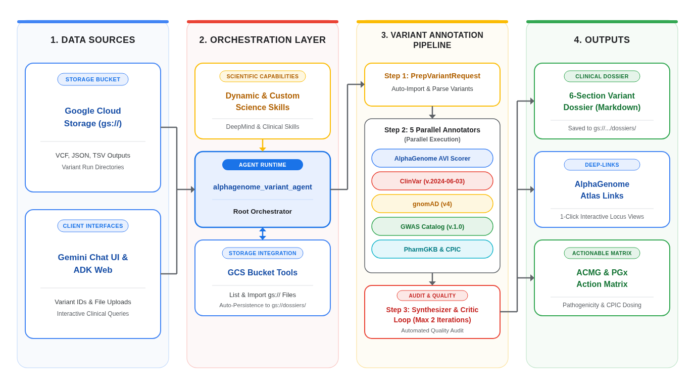
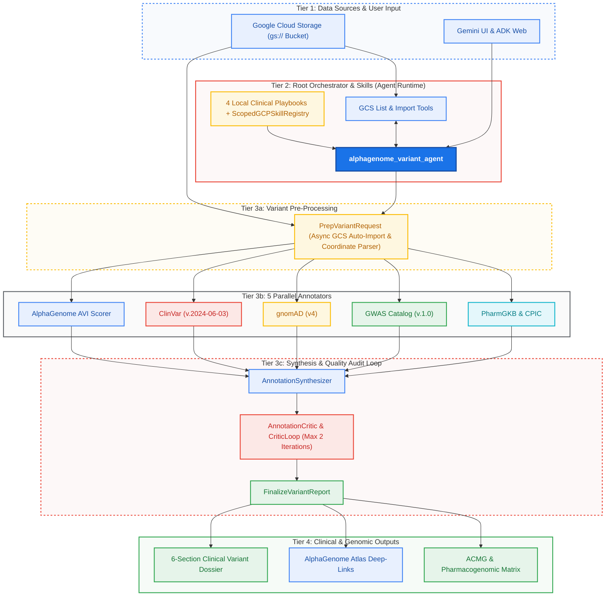

# Variant Annotation Agent

Welcome to the **Variant Annotation Agent** repository. This repository contains a production-ready genomic variant functional interpretation and clinical/population annotation agent built with the **Google Cloud Agent Development Kit (ADK)** on GCP, integrating **4 custom clinical/pharmacogenomic/GWAS/AVI workflow playbooks** with **Google Cloud Agent Registry (`GCPSkillRegistry`)** for **[Google DeepMind Science Skills](https://github.com/google-deepmind/science-skills/tree/main/skills)**, and engineered for deployment onto **Agent Runtime on GCP**.



---

## Core Capabilities

* **Annotation Agent for AlphaGenome's output files**: An end-to-end genomic variant scoring and multi-database annotation platform that allows users to:
  1. **Import AlphaGenome Outputs from Google Cloud Storage (`gs://`) Buckets or Chat Uploads**:
     Directly list and import AlphaGenome output files (`.json`, `.jsonl`, `.tsv`, `.csv`, `.vcf`, `.vcf.gz`) stored in your Google Cloud Storage bucket (`gs://<bucket>/<path>`), or upload/paste AlphaGenome predictions and GRCh38 `chr:pos:ref>alt` / `rsID` identifiers directly in chat.
  2. **Compute & Interpret AlphaGenome Variant Impact (AVI) Scores**:
     Extract or compute **AVI Phred** ($-10 \log_{10}(\text{avi\_quantile})$), **AVI Raw**, **AVI Tail Quantile** ($\text{tail} = 1 - \text{CDF}$), **Impact Tiers** (*High* $\ge 20$, *Moderate-High* $15\text{–}19.99$, *Moderate* $10\text{–}14.99$, *Low* $< 10$), and **18-Modality Attribution Weights** (`MERGED_SPLICING`, `MAX_ABS_RNA_SEQ`, `MAX_ABS_ATAC`, `MAX_ABS_DNASE`, `MAX_ABS_CHIP_TF`, `MAX_ABS_CHIP_HISTONE`, `MAX_ABS_CAGE`, `MAX_ABS_PROCAP`, `MAX_ABS_POLYADENYLATION`, `MAX_ABS_CONTACT_MAPS`, `ALPHAMISSENSE`, `CACTUS_241_WAY`, `PROTEIN_TERMINATION`, `START_LOST`, `STOP_LOST`, `PHASTCONS_470_WAY`, `IS_INSERTION`, `IS_DELETION`), plus clickable **AlphaGenome Atlas** deep-links.
  3. **Annotate Variants in Parallel Across Four Authoritative Genomic Databases**:
     * **ClinVar (v.2024–06-03)** (Landrum et al. 2018) — Germline clinical significance, ACMG classifications, review status gold stars (0–4 stars), and disease phenotypes.
     * **gnomAD (v4)** (Karczewski et al. 2020; Chen et al. 2024) — Joint, exome, and genome allele frequencies across 807,162 individuals on GRCh38, continental ancestry breakdown, ACMG frequency tiers (`BA1`, `BS1`, `PM2_Supporting`), and gene loss-of-function constraint (`pLI`, `LOEUF`).
     * **GWAS Catalog (v.1.0)** (Sollis et al. 2023) — Genome-wide significant trait associations, p-values, odds ratios/betas, risk alleles, and Experimental Factor Ontology (EFO) terms.
     * **PharmGKB** (Whirl-Carrillo et al. 2012, 2021) — Pharmacogenomic clinical evidence levels (`1A`–`4`), VIP star-allele designations, activity scores, and CPIC therapeutic dosing guidelines.
  4. **Custom Clinical Playbooks + Scoped Google Cloud Agent Registry (`SkillToolset`)**:
     Loads the **4 committed clinical/pharmacogenomic/GWAS/AVI workflow skills** in [`app/skills/`](./app/skills/) (`acmg-clinvar-gnomad-triage`, `alphagenome-avi-interpretation`, `gwas-noncoding-variant-mechanisms`, `pharmacogenomics-star-allele-review`) and connects to **Google Cloud Agent Registry** via `ScopedGCPSkillRegistry` (`app/app_utils/skills_loader.py`, populated via `../shared/scripts/sync_skills_to_registry.py`).

---

## Connecting Your AlphaGenome Google Cloud Storage (`gs://`) Bucket

Users can connect and import their AlphaGenome output files from Google Cloud Storage (`gs://`) in **three ways**, depending on whether they are querying buckets in chat, setting a default deployment bucket, or binding an existing enterprise bucket via Terraform.

### Supported AlphaGenome File Formats in GCS

| File Extension | Supported Structure & Fields |
| :--- | :--- |
| **`.json` / `.jsonl`** | AlphaGenome SDK `analyze_variant_effects` outputs, `{"variants": [...]}` arrays, or `{"benchmark_variants": [...]}` payloads with `avi_raw` / `avi_quantile` / `avi_phred` or 18-track `multimodal_tracks` deltas. |
| **`.tsv` / `.csv`** | Tabular files containing `chromosome`, `position`, `ref`, `alt` (or `variant` in `chr:pos:ref>alt` format) and `avi_phred`, `avi_quantile`, or `avi_raw` columns. |
| **`.vcf` / `.vcf.gz`** | VCF v4.2 callsets (plain text or gzip-compressed, up to 50 MB compressed / 100 MB decompressed) with `INFO` tags (`AVI_PHRED=`, `AVI_RAW=`, `AVI_Q=`, `GENE=`). |

---

### Option 1: Pass Any `gs://` Link or Relative Bucket Path Directly in Chat Prompts (Zero Code Changes)

Once deployed, the agent's `PrepVariantRequest` pre-importer (`app/sub_agents/variant_annotation_pipeline.py`) and GCS tools (`app/tools/gcs_bucket.py`) automatically detect any `gs://<bucket>/<path>` link or relative blob path (resolved against `ALPHAGENOME_GCS_BUCKET` / `<project_id>-alphagenome-outputs`) in a user prompt.

* **To list files in your bucket or folder:**
  > *"List the AlphaGenome output files in `gs://my-alphagenome-bucket/cohort-2026/`."*
* **To import, score, and generate a full 6-section clinical dossier (via `gs://` URI or relative path):**
  > *"Import and annotate all variants from `samples/sample_alphagenome_variants.vcf` using the variant annotation pipeline."*

> **IAM Note:** By default, Terraform creates `<project_id>-alphagenome-outputs` (or binds `var.alphagenome_bucket_name`) and grants the deployed Agent Runtime's Workload Identity `roles/storage.objectAdmin` and `roles/storage.legacyBucketReader` scoped strictly to that bucket. For additional buckets, see [Additional Bucket IAM](#additional-bucket-iam-optional) below.

---

### Option 2: Configure a Default Bucket via `ALPHAGENOME_GCS_BUCKET`

By default, `list_alphagenome_bucket_files()` and `save_dossier_to_gcs()` automatically resolve to `ALPHAGENOME_GCS_BUCKET` if set, or `<GOOGLE_CLOUD_PROJECT>-alphagenome-outputs` in GCP deployments.

#### A. During Cloud Build Deployment (`_ENV_VARS`)
When deploying from `applications/pharma-on-gemini-enterprise/` using `shared/cloudbuild.yaml`:

```bash
gcloud builds submit . \
  --project="${PROJECT_ID}" \
  --config=shared/cloudbuild.yaml \
  --substitutions=_AGENT_DIR=variant-annotation-agent,_TF_STATE_BUCKET="${TF_STATE_BUCKET}",_REGION=us-central1,_ENV_VARS=ALPHAGENOME_GCS_BUCKET=your-alphagenome-outputs-bucket
```

#### B. During Local Development (`.env`)
Create a `.env` file in the agent directory and set `ALPHAGENOME_GCS_BUCKET`:

```env
GOOGLE_CLOUD_PROJECT=your-gcp-project-id
GOOGLE_CLOUD_LOCATION=global
ALPHAGENOME_GCS_BUCKET=your-alphagenome-outputs-bucket
```

---

### Option 3: Bind an Existing Bucket in Terraform (`alphagenome_bucket_name`)

By default (`alphagenome_bucket_name = null` in [`terraform/variables.tf`](./terraform/variables.tf)), Terraform creates a dedicated bucket named `<project_id>-alphagenome-outputs`.

If your organization already has an existing GCS bucket where AlphaGenome pipelines deposit outputs (e.g., `my-org-alphagenome-prod`), pass `alphagenome_bucket_name`:

```bash
cd terraform
terraform apply \
  -var="project_id=${PROJECT_ID}" \
  -var="region=us-central1" \
  -var="alphagenome_bucket_name=my-org-alphagenome-prod"
```

Terraform will skip creating a new bucket and instead bind `roles/storage.objectAdmin` for the Agent Runtime identity directly onto `gs://my-org-alphagenome-prod`.

---

### Additional Bucket IAM (Optional)

To grant the Agent Runtime access to another GCS bucket, bind `roles/storage.objectViewer` on that bucket to the Agent Runtime's Workload Identity principal:

```bash
# 1. Retrieve the deployed Agent Runtime's Workload Identity principal
cd terraform
AGENT_IDENTITY=$(terraform output -raw agent_identity)

# 2. Grant Storage Object Viewer on the bucket
gcloud storage buckets add-iam-policy-binding gs://your-external-alphagenome-bucket \
  --member="principal://${AGENT_IDENTITY}" \
  --role="roles/storage.objectViewer"
```

---

### Where Generated Dossiers, Charts & Atlas Metadata Are Saved (`save_artifact` + `gs://<bucket>/dossiers/`)

Every time `variant_annotation_pipeline` finishes validating a report (`FinalizeVariantReport`), it registers **native downloadable artifacts** (`dossier_<slug>.md`, `alphagenome_modalities_<slug>.png`, and `gnomad_ancestry_af_<slug>.png`) directly in Gemini Enterprise's **Artifacts drawer** via ADK `save_artifact`, and saves **two persistent output artifacts** into the `dossiers/` folder of your configured Google Cloud Storage bucket via `save_dossier_to_gcs()` (`app/tools/gcs_bucket.py`):

```text
gs://<your-alphagenome-bucket>/
├── samples/                                                  # Input AlphaGenome VCF, JSON, TSV files
│   ├── sample_alphagenome_variants.vcf
│   ├── sample_alphagenome_outputs.json
│   └── sample_alphagenome_avi_scores.tsv
└── dossiers/                                                 # Auto-saved outputs after every pipeline run
    ├── 20261008_230925_rs4244285_dossier.md                  # 6-Section Clinical Variant Dossier (Markdown)
    └── 20261008_230925_rs4244285_metadata.json               # Structured JSON (Atlas deep-links + 5 annotator payloads)
```

---

## Architectural Design



---

## Repository Structure

```text
├── README.md                                  # Architecture, GCS Bucket Guide & Deployment
├── pyproject.toml                             # Dependencies & build config (uv / hatchling, Python 3.13)
├── uv.lock                                    # Pinned dependency lockfile
├── agents-cli-manifest.yaml                   # Manifest for google-agents-cli@1.8.0
├── Dockerfile                                 # Container image for Cloud Run / Agent Runtime
├── assets/
│   └── architecture.png                       # High-resolution architectural design visual
├── app/
│   ├── agent.py                               # Root ADK Agent + SkillToolset + GCS tools
│   ├── fast_api_app.py                        # FastAPI + A2A + Agent Runtime adapter
│   ├── app_utils/                             # Models, A2A, Agent Runtime adapter, ScopedGCPSkillRegistry
│   ├── skills/                                # 4 committed clinical/genomics workflow playbooks
│   ├── sub_agents/                            # ADK v2 Workflow annotation pipeline, scorer, DB lookup
│   └── tools/                                 # GCS importer, AlphaGenome AVI, ClinVar, gnomAD, GWAS, PharmGKB
├── samples/                                   # Sample AlphaGenome JSON, TSV, and VCF files
├── terraform/                                 # Agent Runtime (via shared module) + GCS AlphaGenome Bucket & IAM
└── tests/                                     # Unit, integration, and evaluation suites
```

---

## Local Development & Testing

1. **Install Dependencies:**
   ```bash
   uv sync --all-groups
   ```

2. **Run Unit Tests:**
   ```bash
   uv run pytest tests/unit
   ```

3. **Start Local FastAPI Server:**
   ```bash
   uv run uvicorn app.fast_api_app:app --reload --port 8080
   ```

---

## Quick Start: End-to-End Cloud Deployment (`shared/cloudbuild.yaml`)

1. **Create a Terraform State GCS Bucket (one-time per project):**
   ```bash
   export PROJECT_ID="your-gcp-project-id"
   export TF_STATE_BUCKET="${PROJECT_ID}-tf-state"

   gcloud storage buckets create "gs://${TF_STATE_BUCKET}" \
     --project="${PROJECT_ID}" \
     --location=us-central1 \
     --uniform-bucket-level-access
   gcloud storage buckets update "gs://${TF_STATE_BUCKET}" --versioning --project="${PROJECT_ID}"
   ```

2. **Optional — Sync Science Skills to Google Cloud Agent Registry:**
   From `applications/pharma-on-gemini-enterprise/`:
   ```bash
   python3 shared/scripts/sync_skills_to_registry.py --project-id "${PROJECT_ID}"
   ```

3. **Deploy via Shared Cloud Build Pipeline:**
   From `applications/pharma-on-gemini-enterprise/`:
   ```bash
   gcloud builds submit . \
     --project="${PROJECT_ID}" \
     --config=shared/cloudbuild.yaml \
     --substitutions=_AGENT_DIR=variant-annotation-agent,_TF_STATE_BUCKET="${TF_STATE_BUCKET}",_REGION=us-central1,_ENV_VARS=ALPHAGENOME_GCS_BUCKET="${PROJECT_ID}-alphagenome-outputs"
   ```

4. **Upload sample AlphaGenome output files to your bucket and test:**
   ```bash
   gcloud storage cp variant-annotation-agent/samples/* "gs://${PROJECT_ID}-alphagenome-outputs/samples/" --project="${PROJECT_ID}"
   ```
   Then ask the deployed agent:
   > *"Import and annotate all variants from `gs://<your-project-id>-alphagenome-outputs/samples/sample_alphagenome_variants.vcf` using the variant annotation pipeline."*

---

## Database & Benchmark References

* **AlphaGenome & Science Skills**: Google DeepMind. *Building a Library of Skills for AI Agents in Science.* Technical Report, 2026 (`https://github.com/google-deepmind/science-skills`).
* **ClinVar (v.2024–06-03)**: Landrum MJ, et al. *ClinVar: improving access to variant interpretations and supporting evidence.* Nucleic Acids Res. 2018;46(D1):D1062–D1067.
* **gnomAD (v4)**: Karczewski et al. 2020; Chen et al. 2024- https://gnomad.broadinstitute.org/publications
* **GWAS Catalog (v.1.0)**: Sollis E, et al. *The NHGRI-EBI GWAS Catalog: knowledgebase and deposition resource.* Nucleic Acids Res. 2023;51(D1):D977–D985.
* **PharmGKB**: Whirl-Carrillo M, et al. *Pharmacogenomics knowledge for personalized medicine.* Clin Pharmacol Ther. 2012;92(4):414–417; and Clin Pharmacol Ther. 2021;110(3):563–572.

> **Research Use Only Disclaimer**: This agent and its outputs are intended strictly for scientific research and variant prioritization. AlphaGenome Variant Impact (AVI) scores and public database annotations do not constitute clinical diagnostic or medical treatment advice.
